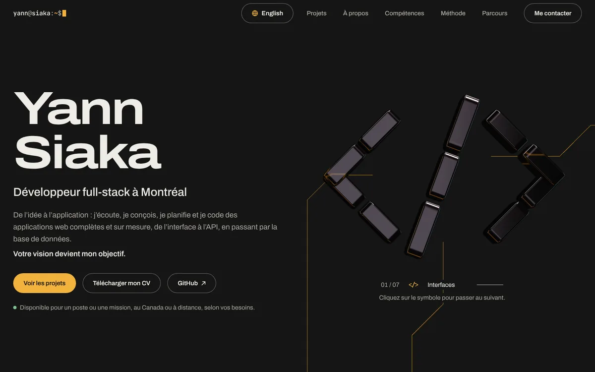

Un portfolio de développeur est déjà une démonstration. Plutôt qu'un modèle tout fait, j'ai écrit celui-ci à la main : du HTML, du CSS et du JavaScript sans framework, assemblés par Vite. Voici les choix qui le structurent.



## Un établi plutôt qu'une vitrine

Le site reprend les objets de mon quotidien de développeur. L'invite de commande en haut de la page suit la section que l'on lit (`yann@siaka:~/projets$`). La méthode se lit comme un historique Git et le parcours comme un fichier CHANGELOG. L'idée : montrer ma façon de travailler autant que ce que j'ai livré.

## Les outils

- **Vite** construit le site : un serveur de développement instantané et un build qui produit plusieurs pages, le français à la racine, l'anglais dans `en/`, et maintenant ce journal.
- **GSAP et ScrollTrigger** animent les révélations au défilement, les projets épinglés et les couches des compétences.
- **Lenis** adoucit le défilement, sauf quand l'appareil demande moins d'animations.
- **three.js** dessine le symbole 3D. Il arrive après la page : le hero se lit sans l'attendre, et sur téléphone il ne se charge qu'au premier geste du visiteur.

## L'accessibilité d'abord

Une page animée doit rester utilisable par tout le monde :

- avec le réglage « réduire les animations », il n'y a ni défilement doux ni animation d'entrée, et tout le contenu est visible tout de suite ;
- un bouton pause fige tout ce qui bouge seul ;
- le texte garde un contraste d'au moins 7:1 ;
- tout se fait au clavier, avec un focus toujours visible.

## Deux langues, sans traduction automatique

La version anglaise est traduite à la main, avec la même structure que la page française. Pour qu'un traducteur automatique ne transforme pas les noms propres en mots ordinaires, ils sont protégés un par un :

```html
<p>Construit avec <span translate="no">Vite</span>, déployé sur Vercel.</p>
```

Sans cette protection, un traducteur automatique risque de lire « Vite » comme l'adverbe français et de le traduire par *quickly*.

## Et ce journal?

Chaque note est un fichier Markdown dans le dépôt. Au build, Vite en fait une page, met à jour la section Journal de l'accueil et le flux Atom. Écrire une note, c'est donc faire un commit, comme pour le reste du code.
